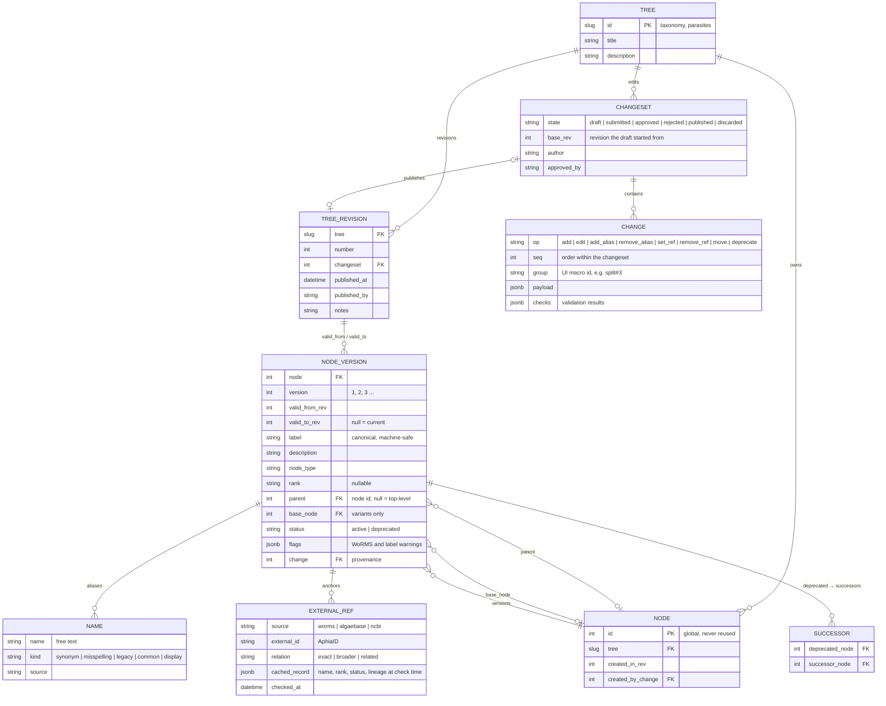

# labeltree-db — Design (draft)

Source-of-truth service for AMPLIfy label hierarchies. Other services
(amplify-datasetman, roi-db, annotation tools) reference labels by
`(tree, node_id)`, optionally pinned to a node version or tree revision. They use
this API to resolve labels, aliases, parents, children and external references
such as WoRMS.

Proposed stack, matching amplify-mediastore: Django + django-ninja (API),
PostgreSQL, Docker Compose. The tree-management web app lives in the same Django
project.

Consumers **pull**. The service pushes no notifications or events.

## 1. Core decision: owned tree, anchored to WoRMS

Two models were considered.

**A. WoRMS portal with overlay.** WoRMS is the tree, and the service proxies it.
An overlay intercepts custom or modified nodes.

**B. Owned tree with WoRMS anchors.** We own every node. A node may carry an
AphiaID, and placement is *checked* against WoRMS, not *derived* from it.

**Decision: B**, borrowing two features from A:

- *Import from WoRMS*: scaffold a node or subtree from an AphiaID, which pulls
  name, rank and lineage.
- *Drift reports*: compare our anchored nodes with current WoRMS and propose a
  draft changeset. Nothing is applied automatically.

Why B:

| Concern | A (portal) | B (owned) |
|---|---|---|
| ROI label stability | Labels move when WoRMS reclassifies or synonymises a taxon. Old annotations change meaning silently. | Node ids are ours and never change meaning. WoRMS changes become reviewed edits. |
| Annotation picklists | Must filter about 500k taxa down to tens or hundreds of usable classes. The overlay ends up being the real tree anyway. | The tree *is* the curated set of usable labels. |
| Non-biological and informal labels (detritus, bubble, "flagellate", morphotypes, "X_or_Y") | Exceptions to WoRMS everywhere | First-class nodes |
| Multiple trees (taxonomy, parasites, morphology, lab-specific) | WoRMS only covers taxonomy | Same machinery for all trees |
| Availability, rate limits, reproducibility | Runtime dependency on marinespecies.org | WoRMS is only needed when editing |
| Versioning | Must snapshot WoRMS plus overlay together | Version our own data |

## 2. Trees and nodes

### Multiple trees

- Trees are **disjoint**. Each has its own nodes, revisions and permissions. Two
  examples are `taxonomy` (general) and `parasites` (internal/external).
- An ROI may be labelled in several trees at once, e.g. a taxon plus an external
  parasite. Combining those labels is up to roi-db and downstream apps.
- Node ids are **globally unique across trees**, so a node id alone is enough to
  resolve a node. Nodes in different trees may share an AphiaID.
- **The tree is the implicit root.** Nodes with `parent = null` are its
  top-level nodes, and a tree may have any number of them. Adding, moving or
  retiring a top-level node changes the tree's top-level set. That is captured by
  the tree revision; there is no root node to version.

### Labels and aliases

- **Only the node id is unique.** Labels may repeat within a tree, e.g.
  `morphotype1` under two genera.
- **Labels must be machine-safe:** `^[A-Za-z0-9][A-Za-z0-9_.-]*$`, so no spaces
  or slashes.
- **Aliases are free text**, such as `Chaetoceros didymus`, misspellings, common
  names and legacy strings. They don't need to be unique.
- `resolve` and `search` match labels and aliases, and return **every** matching
  node at the requested revision. Consumers must store node ids, never labels.
- Because duplicates are allowed, the check `duplicate_label_sibling` raises a
  non-blocking warning when an active sibling already has the same label. That is
  almost always a mistake.

### Fixed node fields

| Field | Notes |
|---|---|
| `label` | machine-safe string |
| `node_type` | `taxon \| informal \| morphotype \| variant \| non_bio \| ambiguous \| group` |
| `rank` | nullable; WoRMS rank vocabulary |
| `parent` | node id or null (top-level) |
| `base_node` | variants only |
| `description` | free text: definition and annotation guidance |
| `aliases[]` | `{name, kind: synonym \| misspelling \| legacy \| common \| display}` |
| `external_refs[]` | `{source, external_id, relation}` plus cached record |
| `status` | `active \| deprecated` |
| `successors[]` | set only on deprecated nodes, may be empty (see §3) |

There is no free-form metadata. Adding a field requires a schema change.

### Node types

`taxon | informal | morphotype | variant | non_bio | ambiguous | group`

**Variant** nodes hold legacy combined labels, such as
`Chaetoceros_didymus_TAG_external_flagellate`. A variant has no AphiaID, and its
`base_node` points to the taxon it qualifies. It sits either under the base taxon
(child) or beside it (sibling), and `base_node` records the link in both cases.
Variants stay valid indefinitely. If they are deprecated later, they remain in the
history like any deprecated node.

## 3. Versioning

There are two levels of versioning.

- **Node version** (`node_id@v`): an integer per node, starting at 1. It
  increases whenever the node's own state changes.
- **Tree revision** (`tree@r`): an integer per tree. It increases once for each
  published changeset and identifies the state of every node at that point.

### What changes a node's version

A node's version increases if any of these changed:

- label, node type, rank, description or base_node
- aliases added or removed
- external refs added, removed or changed
- **parent** (the node was moved)
- **set of immediate active children**: a child was added, deprecated, or moved
  in or out
- status (active → deprecated) and successors
- WoRMS placement flags (see §5)

A child's own edits, such as a rename, do **not** change the parent's version.
Changes don't cascade beyond immediate parent and children.

A node's version increases **at most once per tree revision**, however many
changes in the changeset touch it.

### Storage model



The tree at revision `r` is every `NODE_VERSION` with
`valid_from_rev <= r < valid_to_rev`, where a null `valid_to_rev` counts as
infinity. Children are not stored. They are found from the children's `parent`
pointers at that revision, and the parent's version still increases when its set
of children changes.

At the expected scale (thousands of nodes, hundreds of revisions) this is
plain indexed SQL. Full-tree exports per revision can be cached indefinitely,
because published revisions never change.

### Atomic operations

Every edit is one of eight atomic operations. Changes in a changeset are
**ordered** (`seq`). Each change's preconditions are checked against the state
left by the changes before it.

| Op | Effect | Preconditions |
|---|---|---|
| `add` | Create a node with a new id, under a parent or at top level. | parent active, same tree |
| `edit` | Change label, node_type, rank, description or base_node. | node active |
| `add_alias` / `remove_alias` | | node active |
| `set_ref` / `remove_ref` | Add, change or remove an external ref. | node active |
| `move` | Change parent (or make the node top-level). | new parent active, same tree, no cycle |
| `deprecate` | `status = deprecated`, with optional `successors[]`. | node has **no active children** |

Nothing is ever deleted. "Delete" means deprecate. Deprecated nodes are
**hidden by default** in listings, search, children and exports. A lookup by id
always works and returns:

```json
{"id": 812, "version": 4, "status": "deprecated", "deprecated": true,
 "successors": [1201, 1202], "deprecated_in_rev": 37, ...}
```

**Successors** are informational pointers ("ROIs labelled with this node probably
belong to one of these now"). They are the only record that a merge or split
happened. Old ROIs keep pointing to the deprecated id. How to display or migrate
them is up to downstream apps.

### Merge and split are UI macros

The UI offers presets that expand into ordered atomic changes sharing a `group`
id. Reviewers see the expanded list and every node it touches.

**Merge A into B:**
```
1..n  move     each active child of A → B
n+1   deprecate A  successors=[B]
```

**Split A**, with two variants depending on whether A's meaning changes:

*Narrowing split.* A keeps its meaning, and a sibling takes some children:
```
1     add      A2 (sibling of A)
2..n  move     selected children of A → A2
```
Use this only when old ROIs labelled A are still correct as A.

*Replacing split* (the default preset). A's meaning is no longer valid:
```
1     add      A1 (sibling of A)
2     add      A2 (sibling of A)
3..n  move     each child of A → A1 or A2   (UI requires every child to be assigned)
n+1   deprecate A  successors=[A1, A2]
```

Use the replacing form whenever existing ROIs labelled A might belong to either
new node. Otherwise those ROIs would silently keep a label whose meaning has
narrowed.

### What consumers store

The recommendation is that an ROI annotation stores `(node_id, tree_rev)`. The
node version follows from those two values, and the revision also captures the
hierarchy context at that moment. Storing `(node_id, node_version)` is supported
too.

## 4. Changesets and concurrency

- Edits accumulate in a draft changeset that records its `base_rev`.
- When a draft is submitted, approved or published, all checks run again against
  the latest revision.
- **Conflict rule:** if any node touched by the changeset has a newer version
  than at `base_rev`, publishing is blocked. The drafter must rebase (re-apply on
  latest, re-run checks) and resubmit.
- Publishing is atomic. It creates `TREE_REVISION r+1`, closes the old node
  versions (`valid_to_rev = r+1`) and opens the new ones.

**Blocking errors** (structural only):
- a cycle
- a parent that is deprecated or in another tree
- deprecating a node that still has active children
- a label that isn't machine-safe
- a conflicting base revision

**WoRMS problems are warnings, never errors** (see §5).

## 5. WoRMS placement checks (warnings and flags)

These run when a change adds or moves a node, or sets or changes a WoRMS ref.
Results are stored on the change for review **and** as `flags` on the published
node version. That lets downstream users and tree crawlers see them.

```
lineage(X) = WoRMS AphiaClassificationByAphiaID(X), as a list of (rank, AphiaID)

for node N with aphia a, placed under parent P:
  unaccepted_aphia     WoRMS status of a is not accepted (store valid_AphiaID)
  out_of_lineage       A = nearest ancestor with an exact WoRMS ref
                       (nodes without refs are skipped); A.aphia not in lineage(a)
  encloses_foreign     some nearest anchored descendant D has a not in lineage(D.aphia)
  rank_order           N's rank is at or above A's rank (e.g. genus under species)
  skipped_known_taxon  a WoRMS taxon between A and N exists elsewhere in this tree
  duplicate_aphia      another active node in this tree has the same exact aphia
```

Example flags field: `{"out_of_lineage": true, "rank_order": false, ...}`, plus
a `worms_flag_detail` explanation. The API returns `has_worms_warnings: true`
whenever any flag is set.

Flags record WoRMS as it was when the node version was published. Changes
in WoRMS afterwards are surfaced by **drift reports**, which never mutate
published versions.

## 6. Users and permissions

Roles are assigned per tree and can be combined:

| Role | Can |
|---|---|
| `reader` | Read published revisions. |
| `drafter` | Create and edit drafts, run checks, and submit. |
| `approver` | Approve or reject submitted drafts, and publish. Holding both `drafter` and `approver` lets a user approve and publish their own changes. |
| `admin` | Manage tree settings and assign roles. |

**Authentication** is kept simple:
- Django users and sessions for the web app.
- Per-user or per-service API tokens, sent in a header (django-ninja `APIKey`),
  for scripts and services.

Service accounts for roi-db and datasetman get the `reader` role.

## 7. API sketch (django-ninja, `/api/v1`)

### Read

Read endpoints accept `?rev=N` (default: latest) and `?include_deprecated=false`.

```
GET /trees                                     list trees
GET /trees/{tree}                              info, latest revision
GET /trees/{tree}/revisions                    revision list, notes, author
GET /trees/{tree}/revisions/{r}/changes        what that revision changed

GET /nodes/{id}                                current or ?rev= state (see shape below)
GET /nodes/{id}/versions                       version history with revision ranges
GET /nodes/{id}/versions/{v}                   a specific node version
GET /nodes/{id}/children
GET /nodes/{id}/ancestors                      path to root
GET /nodes/{id}/descendants?depth=
GET /nodes/{id}/successors                     follow successor chains to active nodes

GET /trees/{tree}/top                          top-level nodes
GET /trees/{tree}/export?format=json|nested|csv
GET /trees/{tree}/resolve?name=Chaetoceros_peruvianis
                                               all nodes whose label or alias matches exactly
GET /trees/{tree}/search?q=chaeto              typeahead
GET /trees/{tree}/diff?from=3&to=4
GET /external/worms/{aphia_id}/nodes           reverse lookup across trees
```

Node response shape:

```json
{
  "id": 431, "tree": "taxonomy", "version": 3, "rev": 42,
  "label": "Chaetoceros_didymus", "description": "",
  "node_type": "taxon", "rank": "species",
  "aliases": [{"name": "Chaetoceros didymus", "kind": "display"}],
  "external_refs": [{"source": "worms", "id": "149120", "relation": "exact",
                     "status": "accepted"}],
  "parent": {"id": 402, "label": "Chaetoceros", "version": 7},
  "children": [{"id": 433, "label": "Chaetoceros_didymus_TAG_external_flagellate"}],
  "base_node": null,
  "status": "active", "deprecated": false, "successors": [],
  "has_worms_warnings": false, "flags": {}
}
```

### Write (token or session auth, role-checked)

```
POST /trees/{tree}/changesets                  open a draft (records base_rev)
POST /changesets/{cs}/changes                  append one or more atomic changes (ordered)
PATCH/DELETE /changesets/{cs}/changes/{seq}    edit, reorder or remove a pending change
POST /changesets/{cs}/macros/merge {node, into}            expands to atomic changes
POST /changesets/{cs}/macros/split {node, new_nodes, child_assignment, replace: true}
POST /changesets/{cs}/import/worms {aphia_id, under, with_lineage}
GET  /changesets/{cs}/preview                  draft tree, diff, check results
POST /changesets/{cs}/rebase
POST /changesets/{cs}/submit                   drafter
POST /changesets/{cs}/approve | reject         approver
POST /changesets/{cs}/publish                  approver
GET  /trees/{tree}/drift                       WoRMS drift report (can open a draft)
```

**Caching:** a response pinned with `?rev=` or a node version never changes.
Responses for "latest" include `X-Tree-Revision` and an `ETag`. Consumers poll
`GET /trees/{tree}` to see whether the revision has moved.

## 8. Management web app

Same Django project, using server-rendered templates with htmx.

- Tree browser: search, show or hide deprecated nodes, warning badges.
- Node page: current state, version history, WoRMS card, successors.
- Draft editing, with each check result shown inline. Merge and split are
  wizards that expand into an ordered list of atomic changes, which can be
  edited before submitting.
- Review shows the ordered change list, grouped by macro, and the set of
  affected nodes with their old → new versions.
- "Add from WoRMS": search by name, pick a record, and accept the suggested
  parent from the lineage.
- Review: diff view, approve or reject, publish with notes.

## 9. Bootstrapping

Revision 1 of `taxonomy` is seeded by an admin import, without approval, from
`amplify-datasetman/data/labeltrees/Jan2022_NES_taxonomy.json`:

- `aphia_id` → `EXTERNAL_REF`; WoRMS lineage nodes become taxon nodes with their
  own AphiaIDs.
- `non_worms` buckets → `non_bio`, `informal` or `ambiguous`; `morphotype_reason`
  → `morphotype`.
- Dataset labels → labels (already machine-safe). The display form, with
  spaces, becomes an alias.
- `_TAG_` labels → `variant` nodes with `base_node` set.

Revision 1 of `parasites` is seeded from the parasite `_TAG_` suffixes.

## 10. Decisions log (latest round)

- Successors on deprecate: **optional**. The UI nudges for them on merge and
  split presets.
- Rank: **free text**. `rank_order` checks only compare ranks they recognise
  from WoRMS.
- Draft visibility: **drafters, approvers and admins** of that tree.
- WoRMS checks run **live**, while editing and again at publish. The service
  needs network access to marinespecies.org. If WoRMS is unreachable, the change
  records `checks: unavailable` and publishing is still allowed, because WoRMS
  issues are warnings only.

## 11. WoRMS versioning and what we store

WoRMS has no releases or version numbers. It is edited continuously.

- **AphiaIDs are permanent.** When a name becomes a synonym, its record stays
  and gets `status: unaccepted`, with `valid_AphiaID` pointing to the accepted
  name.
- Each record has a `modified` timestamp. `AphiaRecordsByDate` lists the
  records changed in a date range.
- The API has no per-record history. The website shows some edit history.
- Dated snapshots exist outside the live API: periodic DwC-A exports and
  archived WoRMS versions in GBIF ChecklistBank.

What this service does as a result:

- Each `EXTERNAL_REF` stores the WoRMS record as fetched (`cached_record`),
  plus `checked_at` and WoRMS's `modified` time. A node version therefore
  records what WoRMS said when it was published, which is our own snapshot of
  the parts we use.
- **Drift reports** call `AphiaRecordsByDate` since the last drift run, filtered
  to AphiaIDs used in the tree, and re-check lineage for those. Changes found
  become a proposed draft.
- Citation and provenance: "WoRMS, accessed <checked_at>", per ref.
